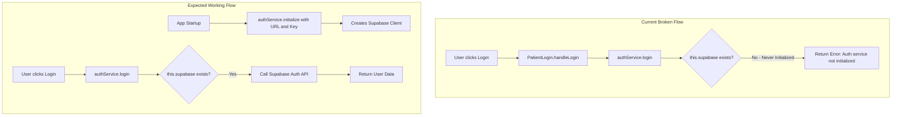

# Authentication Fix Plan - Login & Register Not Working

## Root Cause Analysis

After analyzing the codebase, I've identified **the primary issue**: The [`authService`](services/authService.ts:33) is **never initialized** with Supabase credentials.

### Problem Details

1. **AuthService Initialization Gap**
   - The [`authService`](services/authService.ts:425) is exported as a singleton instance
   - It has an [`initialize()`](services/authService.ts:43) method that must be called with Supabase URL and Key
   - **This method is NEVER called anywhere in the application**

2. **Supabase Client Mismatch**
   - [`supabaseClient.ts`](services/supabaseClient.ts:1) creates its own Supabase client via [`getSupabase()`](services/supabaseClient.ts:13)
   - [`authService.ts`](services/authService.ts:1) creates a SEPARATE Supabase client internally
   - The authService's internal client is `null` because [`initialize()`](services/authService.ts:43) is never called

3. **Login Flow Failure**
   - When [`PatientLogin`](pages/PatientLogin.tsx:28) calls [`authService.login()`](services/authService.ts:179)
   - The method checks `if (!this.supabase)` at [line 180](services/authService.ts:180)
   - Since `this.supabase` is `null`, it returns `{ success: false, error: 'Auth service not initialized' }`
   - Same issue affects [`StaffLogin`](pages/StaffLogin.tsx:27) and registration

4. **Invalid Supabase Anon Key**
   - The key in [`.env.local`](.env.local:2) is `sb_publishable_BMNfBlBP-0jw7QOe-jtj_A_EVm2JsoS`
   - Valid Supabase anon keys start with `eyJ` (JWT format)
   - The current key format `sb_publishable_*` is NOT a valid Supabase anon key

## Architecture Flow Diagram



## Solution

### Step 1: Fix Supabase Anon Key
Get the correct anon key from Supabase Dashboard:
1. Go to https://app.supabase.com
2. Select your project
3. Navigate to Project Settings > API
4. Copy the `anon public` key (starts with `eyJ...`)
5. Update [`.env.local`](.env.local:2)

### Step 2: Initialize AuthService on App Startup
Add initialization in [`App.tsx`](App.tsx:166) inside the existing `useEffect`:

```typescript
// In App.tsx, around line 235-248 where services are initialized
useEffect(() => {
    try {
        const supabaseUrl = import.meta.env.VITE_SUPABASE_URL;
        const supabaseKey = import.meta.env.VITE_SUPABASE_ANON_KEY;
        
        if (supabaseUrl && supabaseKey) {
            // Initialize authService with Supabase credentials
            authService.initialize(supabaseUrl, supabaseKey);
            
            // Also initialize other services
            const supabaseClient = getSupabase();
            if (supabaseClient) {
                clinicService.initialize(supabaseClient);
                patientService.initialize(supabaseClient);
            }
        }
    } catch (e) {
        console.warn('Service initialization error:', e);
    }
    // ... rest of clinic loading logic
}, []);
```

### Step 3: Ensure user_profiles Table Exists
The [`authService.signup()`](services/authService.ts:121) creates a record in `user_profiles` table. Ensure this table exists in Supabase:

```sql
CREATE TABLE IF NOT EXISTS public.user_profiles (
    id UUID PRIMARY KEY REFERENCES auth.users(id) ON DELETE CASCADE,
    email TEXT NOT NULL,
    phone TEXT,
    name TEXT NOT NULL,
    role TEXT NOT NULL DEFAULT 'PATIENT',
    clinic_id TEXT,
    is_verified BOOLEAN DEFAULT FALSE,
    metadata JSONB DEFAULT '{}',
    created_at TIMESTAMPTZ DEFAULT NOW()
);

-- Enable RLS
ALTER TABLE public.user_profiles ENABLE ROW LEVEL SECURITY;

-- Allow users to read/write their own profile
CREATE POLICY "Users can view own profile" ON public.user_profiles
    FOR SELECT USING (auth.uid() = id);

CREATE POLICY "Users can update own profile" ON public.user_profiles
    FOR UPDATE USING (auth.uid() = id);

-- Allow insert during signup (allow anon inserts for profile creation)
CREATE POLICY "Enable insert for users" ON public.user_profiles
    FOR INSERT WITH CHECK (true);
```

## Files to Modify

| File | Change Required |
|------|-----------------|
| [`.env.local`](.env.local) | Replace anon key with valid JWT key from Supabase |
| [`App.tsx`](App.tsx:235) | Add `authService.initialize()` call |
| Supabase Dashboard | Create `user_profiles` table if missing |

## Verification Steps

1. After fix, open browser DevTools Console
2. Try to login - should see Supabase API calls in Network tab
3. Check for errors in Console
4. Successful login should redirect to patient tracker

## Summary

The login/register functionality is broken because:
1. **AuthService is never initialized** - The singleton has no Supabase client
2. **Invalid Supabase key format** - The anon key in `.env.local` is not a valid JWT

The fix requires:
1. Getting the correct Supabase anon key from the dashboard
2. Adding `authService.initialize()` call in App.tsx on startup
3. Ensuring the `user_profiles` table exists in Supabase
